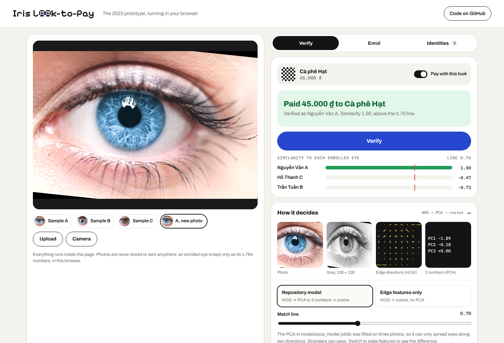

# Iris Look-to-Pay

**Pay by looking.** A 2023 prototype of the software for smart glasses that recognise their wearer by the iris and use it to approve a payment. It enrols an eye from a close-up photo, then verifies new photos against everyone enrolled.

**[Try it in your browser →](https://donganh1409.github.io/iris_project/)** Nothing to install. Photos never leave the page.



## How it decides

| Step | What happens | Code |
| --- | --- | --- |
| 1. Photo | A close-up of one eye, from a webcam or a file | `app.py` |
| 2. Grey, 128 × 128 | Colour is dropped and the photo is resized to a small square | `cv2.cvtColor`, `cv2.resize` |
| 3. Edge directions | HOG measures edges in 9 directions for each 16 × 16 cell: 1,764 numbers | `skimage.feature.hog` |
| 4. Three numbers | PCA keeps the 3 directions in which the training photos differ most | `train_pca.py`, `models/pca_model.joblib` |
| 5. Decide | Cosine similarity to every enrolled eye. Above 0.7, it is a match | `match()` in `app.py` |

## Two ways to run it

### In the browser (the live demo)

`docs/` is a static web version of `app.py`. It is the same pipeline, ported from Python to JavaScript (`docs/iris-core.js`): OpenCV's grey conversion and bilinear resize, scikit-image's HOG with the same settings, and the saved PCA exported to `docs/model/pca.json`. On the three training photos the browser's HOG matches scikit-image to within 1e-7, and the PCA numbers to about 0.01 (the browser decodes JPEGs slightly differently from OpenCV).

```bash
cd docs
python -m http.server 8000
# open http://localhost:8000
```

It adds three things the Streamlit app does not have:

- **A pay flow.** "Pay 45.000 ₫ to Cà phê Hạt" with messages written for the person at the counter, not for the developer.
- **Two models side by side.** The repository's PCA model (match line 0.70), or the raw edge features with no PCA (match line 0.90). There is also a slider to move the line.
- **Privacy by default.** No photo is saved. An enrolled eye is kept only as its numbers, in the browser's local storage, and can be deleted.

### The original Streamlit app

```bash
pip install -r requirements.txt
streamlit run app.py
```

Verify an eye, add a new identity from an uploaded close-up, or list and delete identities. The database is `data/iris_features.joblib`. It holds three sample identities, enrolled from `train_images/A.jpg`, `B.jpg` and `C.jpg`.

To retrain the PCA and refresh the web version:

```bash
python train_pca.py                 # writes models/pca_model.joblib
python scripts/export_web_model.py  # writes docs/model/pca.json
python scripts/check_web_port.py    # prints the numbers the web version should show
```

## What is built, and what is not

| Built | Not built yet |
| --- | --- |
| Enrol from a photo, verify from a webcam or an upload | Glasses with an eye-facing camera |
| HOG → PCA → cosine, match above 0.7 | Finding the iris and unrolling it before comparing |
| List and delete identities | A liveness check (a printed photo would pass) |
| A browser version with a pay flow | Encrypted storage on the device |

**Read the numbers as a sketch, not a result.** The PCA was fitted on three photos, so it can only spread eyes along two directions, and strangers can pass. Accuracy has never been measured on enough people to know how often a stranger is let in or the owner is refused. HOG also reads the whole photo, so lashes, eyelids and reflections weigh as much as the iris itself.

## Repository

```
app.py                     Streamlit app: verify, enrol, list and delete
train_pca.py               fits the PCA on train_images/
models/pca_model.joblib    the saved PCA (3 components)
data/iris_features.joblib  enrolled identities: name -> 3 PCA numbers
train_images/              A.jpg, B.jpg, C.jpg
docs/                      the browser version (GitHub Pages)
scripts/                   export the PCA for the web, check the port
```

## Author

[Dong Anh Nguyen](https://github.com/donganh1409): concept, interaction design and code. Part one of a series on interfaces that disappear into the moment they serve.
